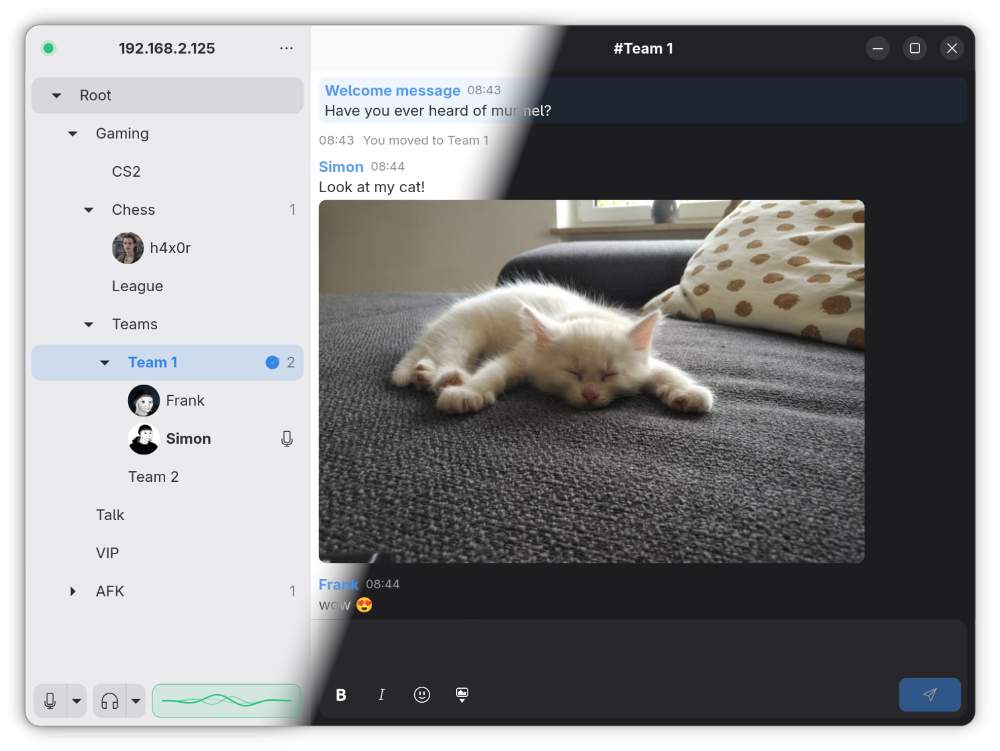
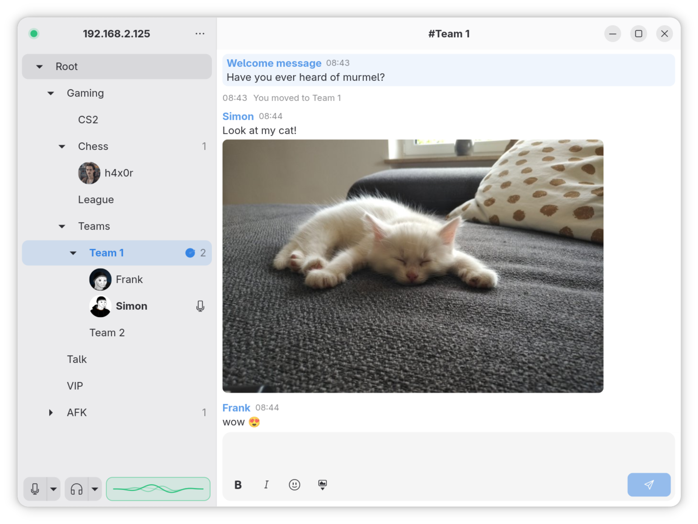
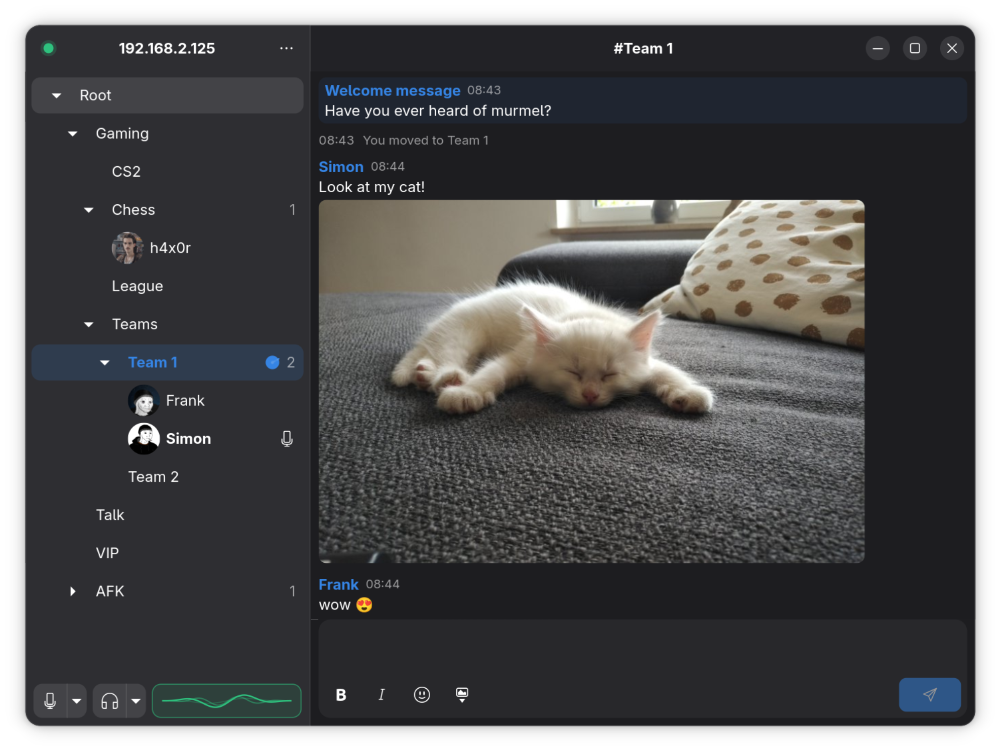
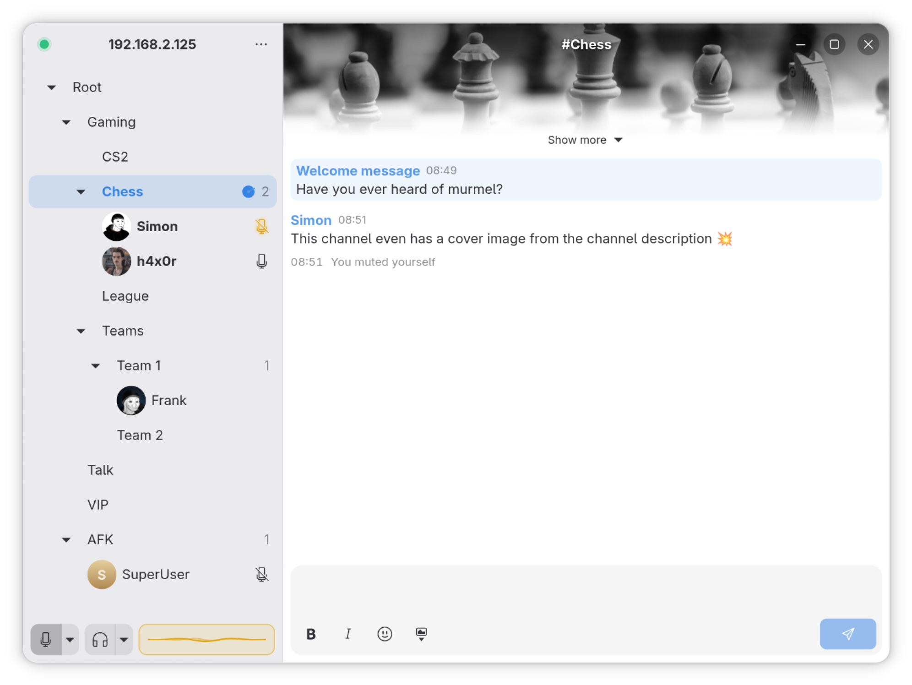
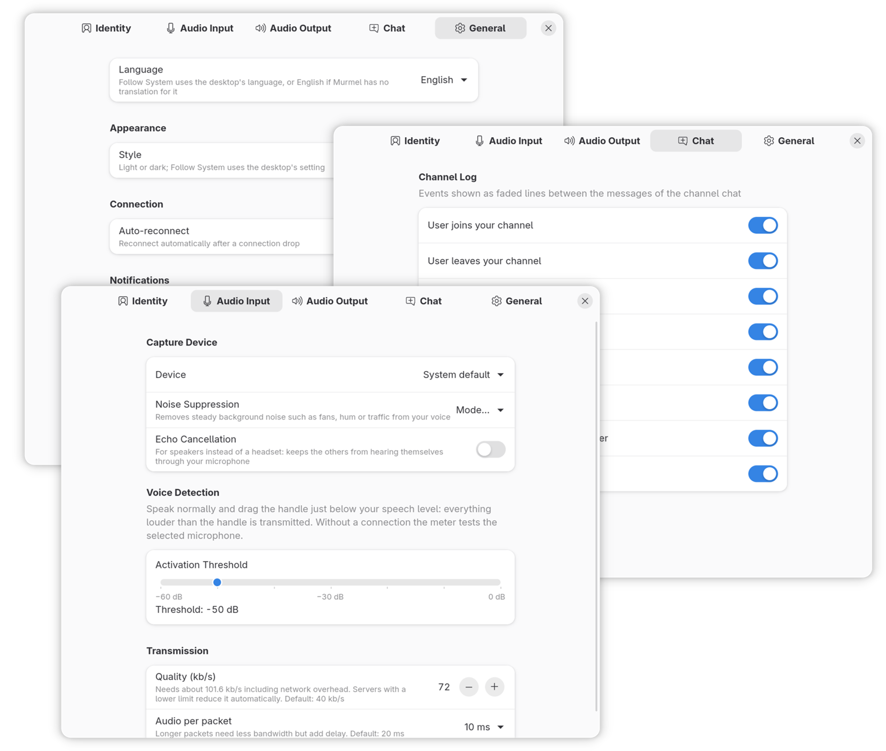

<div align="center">

<h1>&nbsp;Murmel</h1>

<p><strong>A <a href="https://www.mumble.info/">Mumble</a> voice chat client for GNOME</strong><br>
written in Go with GTK&nbsp;4 and Libadwaita</p>

<p>
  <a href="https://simon-tschoep.de/software/murmel/">Website</a>&nbsp;·
  <a href="#install">Install</a>&nbsp;·
  <a href="#building-from-source">Build</a>&nbsp;·
  <a href="CONTRIBUTING.md">Contribute</a>
</p>

<p>
  <a href="https://github.com/one337/murmel/actions/workflows/verify.yml"></a>
  <a href="LICENSE"></a>
</p>



</div>

## Features

- Adaptive GNOME interface: channel tree in a sidebar, chat in the content
  pane, works on narrow windows; light, dark or the system's style
- Voice over encrypted UDP with automatic TCP fallback, Opus codec
- Voice activity detection with an absolute threshold; a live voice meter
  shows when you are heard, and when your voice is detected but not sent
  (muted or not connected)
- Noise suppression and echo cancellation (WebRTC)
- Adjustable voice quality (32–192 kb/s), limited to the server's bandwidth
- Input and output device selection right from the status bar
- Adjustable jitter buffer and audio per packet
- Saved connections; server passwords are stored securely in the desktop
  keyring
- Client certificates: create, import, export and manage them in the app;
  trust-on-first-use server certificates
- Avatars: see other users' pictures and set your own, per connection or
  as a default
- Text chat with channel messages and private conversations, formatting,
  emoji and images, unread markers
- Channel descriptions shown above the chat, with a banner for a leading
  wide image
- Channel editor: name, position, user limit, password, the description
  (with a formatting toolbar and live preview), groups and permissions
- Password-protected channels ask for the password when you join
- Server administration: kick, ban, ban list, registered users
- Desktop notifications for messages and events (configurable)
- Event sounds with per-event choice (built-in or your own audio files)
- `mumble://` links

## Screenshots

<table>
  <tr>
    <td width="33%"></td>
    <td width="33%"></td>
    <td width="33%"></td>
  </tr>
  <tr>
    <td align="center"><sub>Light style</sub></td>
    <td align="center"><sub>Dark style</sub></td>
    <td align="center"><sub>Channel with a cover image</sub></td>
  </tr>
</table>

Murmel follows the desktop's light or dark style, or keeps the one you pick
in Preferences. A channel description that starts with a wide image becomes
the channel's cover image.

## Install

Murmel is distributed as a Flatpak from its own repository. With Flatpak
and Flathub set up (see https://flathub.org/setup):

```sh
flatpak install --user https://simon-tschoep.de/software/murmel/io.github.murmel.Murmel.flatpakref
flatpak run io.github.murmel.Murmel
```

Updates then arrive through GNOME Software or `flatpak update`.

On Fedora, Murmel is also available as an RPM from
[Copr](https://copr.fedorainfracloud.org/coprs/one337/murmel/):

```sh
sudo dnf copr enable one337/murmel
sudo dnf install murmel
```

<p align="center">
  <br>
  <sub>Preferences for identity, audio, chat and general behavior</sub>
</p>

## Building from source

Requirements:

- Go 1.27 or newer
- GTK 4 and Libadwaita development files (GNOME 47+ recommended)
- libopus development files (`opus-devel` on Fedora, `libopus-dev` on
  Debian/Ubuntu)
- WebRTC audio processing 2.x development files, for noise suppression
  (`webrtc-audio-processing-devel` on Fedora,
  `libwebrtc-audio-processing-dev` on Debian/Ubuntu); a C++20 compiler
- PulseAudio or PipeWire (with `pipewire-pulse`) at runtime

Dependencies are vendored, so the build works offline:

```sh
go build -mod=vendor -o murmel ./cmd/murmel
```

The settings schema must be installed (or `GSETTINGS_SCHEMA_DIR` pointed at
a directory compiled with `glib-compile-schemas data/`); without it Murmel
falls back to in-memory settings.

The first build compiles the GTK bindings and takes several minutes; later
builds are fast.

### Flatpak

```sh
flatpak-builder --user --install --force-clean build-flatpak packaging/io.github.murmel.Murmel.json
```

The manifest uses the GNOME 51 runtime and the Go SDK extension from
Flathub.

## Development

```sh
tools/verify.sh          # gofmt, vet, build, tests, race detector,
                         # govulncheck, schema and i18n checks
go test -mod=vendor ./...
```

- `internal/protocol/gumble` is a patched fork of
  [layeh/gumble](https://github.com/layeh/gumble); every change is
  documented in [PATCHES.md](PATCHES.md).
- `tools/harness` contains a local Mumble server setup and test bots for
  end-to-end voice tests, see its README.
- UI strings go through `tr()`; regenerate `po/murmel.pot` with
  `tools/update-pot.sh`.
- `tools/sounds/gen.py` synthesizes the built-in event sounds.

### Releases

`tools/release.sh <x.y.z>` bumps the version and release notes, tags the
commit, builds a signed Flatpak repository into `web/` (with
`.flatpakrepo`, `.flatpakref`, a single-file bundle and an index page) and
uploads it to the website (`--upload` repeats only the upload). Settings
are in `tools/release.conf` and an untracked `tools/release.local.conf`
(upload target); the signing key is kept outside the repository.

## Contributing

Bug reports, ideas, translations and code are welcome; see
[CONTRIBUTING.md](CONTRIBUTING.md).

## Translations

Murmel is available in English and German; how to add or improve a
translation is described in [po/README.md](po/README.md).

## License

Murmel, including its app icon, is licensed under GPL-3.0-or-later, see
[LICENSE](LICENSE).
Murmel is not affiliated with the Mumble project.
